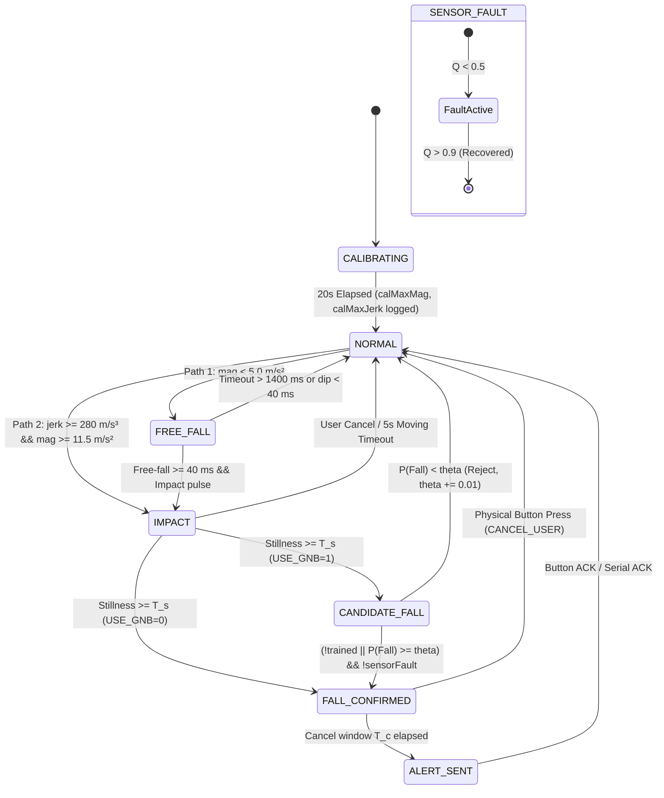

# FallGuard v2 — System Architecture & Specification

> **Firmware Version:** 2.0-Production  
> **Target Hardware:** ESP32-WROOM-32 (Xtensa Dual-Core LX6, 240 MHz, 320 KB SRAM) + InvenSense MPU6050 6-Axis IMU (I2C 0x68)  
> **Units Convention:** Acceleration in $\text{m/s}^2$, Jerk in $\text{m/s}^3$, Time in milliseconds ($\text{ms}$) or microseconds ($\mu\text{s}$)

---

## 1. System Overview

FallGuard v2 is an embedded, paper-grade wearable fall detection system designed for elderly care and high-risk occupational monitoring. The firmware executes on bare-metal ESP32 hardware without cloud dependencies, providing real-time deterministic fall classification with under 100 ms latency post-stillness.

### Processing Pipeline
1. **Kinematic Acquisition (50 Hz):** Reads raw acceleration registers from MPU6050 over I2C at 400 kHz.
2. **Sensor Integrity Layer (`USE_INTEGRITY`):** Evaluates multi-criterion validity $v_k$ and quality index $Q$ using hysteresis to prevent false alarms during hardware faults.
3. **Dual-Path Kinematic Gating:**
   - **Path 1 (Classical Free-Fall):** Free-fall dip ($a < 5.0\text{ m/s}^2$, $\ge 40\text{ ms}$) followed by impact ($a \ge 22.0\text{ m/s}^2$, $J \ge 500\text{ m/s}^3$).
   - **Path 2 (`USE_PATH2` Direct High-Jerk):** High-jerk sudden impact ($J \ge 280\text{ m/s}^3$, $a \ge 11.5\text{ m/s}^2$) capturing low-clearance slips and trips without sustained free-fall.
4. **Adaptive Validation (`USE_ADAPTIVE`):** Modulates stillness duration $T_s$ via windowed motion energy $E_k$, and modulates cancellation window $T_c$ via impact severity ratio $m$.
5. **Lifelong Machine Learning (`USE_GNB`):** Online Gaussian Naive Bayes using Welford's incremental algorithm with cold-start lockout prevention.

---

## 2. Finite State Machine (FSM)



---

## 3. Modular Feature Flags & Interactions

All compile-time options are isolated in the `// ===== CONFIGURATION =====` block of `firmware/FallGuard_v2.ino`. When a flag is set to `0`, its code and memory footprint are eliminated by the preprocessor while preserving standard baseline behavior.

| Compile Flag | Default | Description When Enabled (`1`) | Fallback When Disabled (`0`) |
| :--- | :---: | :--- | :--- |
| `USE_WIFI` | `1` | Starts Wi-Fi SoftAP/Station and asynchronous HTTP JSON web server. | Wi-Fi radio powered off; all telemetry routed exclusively over USB Serial. |
| `USE_GNB` | `1` | Extracts 6-D impact features and classifies via Online Gaussian Naive Bayes with cold-start lockout prevention. | Candidate falls advance directly to `FALL_CONFIRMED` based solely on dual-path rule engine. |
| `USE_INTEGRITY` | `1` | Calculates per-sample validity $v_k$, quality index $Q$, hysteresis fault detection, and fault buzzer pattern. | Assumes IMU is always valid ($Q=1.0$); no fault state buzzer or suppression. |
| `USE_ADAPTIVE` | `1` | Dynamically adapts $T_s \in [1500, 3000]\text{ ms}$ and $T_c \in [3000, 8000]\text{ ms}$ based on energy $E_k$ and impact severity $m$. | Fixed durations: $T_s = \text{STILL\_MS}$ ($2200\text{ ms}$), $T_c = \text{CANCEL\_MS}$ ($5000\text{ ms}$). |
| `USE_STILLNESS` | `1` | Requires post-impact quiescent stillness before confirming a fall event. | Direct impact trigger without stillness verification. |
| `USE_PATH2` | `1` | Enables secondary direct high-jerk impact branch for trips/slips lacking zero-g dip. | Requires primary free-fall phase for all fall detections. |

---

## 4. Telemetry Schema (Part E Specification)

Telemetry is transmitted at 50 Hz over USB Serial at 115200 baud. Every sample during device operation adheres to the following CSV column contract:

```
TELEMETRY,<ms>,<mag>,<jerk>,<state>,<conf>,<activity>,<fallCount>,<nonFallCount>,<theta>,<impThresh>,<jerkThresh>,<trial_id>,<Q>,<E>,<sensor_state>
```

| Index | Field Name | Data Type | Units / Format | Description |
| :---: | :--- | :---: | :--- | :--- |
| **0** | `Header` | String | Literal `"TELEMETRY"` | Telemetry line discriminator |
| **1** | `timestamp_ms` | Integer | $\text{ms}$ | Microcontroller boot time (`millis()`) |
| **2** | `mag` | Float | $\text{m/s}^2$ | Smoothed total acceleration magnitude ($a_{\text{smooth}}$) |
| **3** | `jerk` | Float | $\text{m/s}^3$ | Rate of change of acceleration magnitude |
| **4** | `state` | String | String | Current FSM state (`Normal`, `Impact`, `FALL CONFIRMED`, etc.) |
| **5** | `conf` | Float | $0.000 - 1.000$ | Classifier posterior probability $P(\text{Fall})$; `-1.0` or `0.0` if untrained |
| **6** | `activity` | String | Enum | Inferred baseline activity (`STILL`, `WALKING`, `RUNNING`) |
| **7** | `fallCount` | Integer | Count | Number of confirmed fall examples trained in GNB |
| **8** | `nonFallCount` | Integer | Count | Number of non-fall examples trained in GNB |
| **9** | `theta` | Float | $0.500 - 0.850$ | Current adaptive classifier decision threshold $\theta$ |
| **10** | `impThresh` | Float | $\text{m/s}^2$ | Dynamic impact threshold (nominal $22.0\text{ m/s}^2$) |
| **11** | `jerkThresh` | Float | $\text{m/s}^3$ | Dynamic jerk threshold (nominal $500.0\text{ m/s}^3$) |
| **12** | `trial_id` | String | Alphanumeric | Active protocol trial identifier or `"NONE"` |
| **13** | `Q` | Float | $0.00 - 1.00$ | Sensor integrity quality index ($Q = 0.9 Q + 0.1 v_k$) |
| **14** | `E` | Float | Dimensionless | Windowed motion energy ($E_k = 0.98 E_{k-1} + 0.02 (a - 9.81)^2$) |
| **15** | `sensor_state` | String | `"OK"` / `"FAULT"` | Hardware health status determined by hysteresis on $Q$ |

### Diagnostic Performance Lines
Every 5000 ms, the firmware emits a comment statistic line:
```
# STAT,<loop_us_mean>,<loop_us_max>,<actual_hz>,<free_heap>,<min_free_heap>
```

---

## 5. Mathematical Formulations

### 5.1 Accelerometer Scaling & Conversion
MPU6050 configured for $\pm 8g$ full-scale range (Register `0x1C` = `0x10`, scale factor $4096\text{ LSB}/g$):
$$a_i = \left(\frac{\text{raw}_i}{4096.0}\right) \times 9.80665 \quad [\text{m/s}^2]$$
$$a_{\text{mag}} = \sqrt{a_x^2 + a_y^2 + a_z^2}$$

### 5.2 Sensor Integrity Metric ($v_k$)
Sample validity $v_k \in \{0, 1\}$ evaluates:
$$v_k = \mathbb{I}\left( \text{I2C\_OK} \land (a_{\text{mag}} \ge 2.0) \land (\forall i, |r_i| < 32700) \land (\Delta_{\text{axis}} > 2) \land (\Delta t \le 40000\,\mu\text{s}) \right)$$
Exponential smoothing quality index:
$$Q_k = 0.9 \cdot Q_{k-1} + 0.1 \cdot v_k$$
Fault hysteresis:
$$\text{State} = \begin{cases} \text{FAULT} & \text{if } Q_k < 0.5 \\ \text{OK} & \text{if } Q_k > 0.9 \end{cases}$$

### 5.3 Adaptive Timing Equations (`USE_ADAPTIVE`)
**Windowed Motion Energy:**
$$E_k = 0.98 \cdot E_{k-1} + 0.02 \cdot (a_{\text{smooth}} - 9.81)^2, \quad E_0 = 1.0$$
**Adaptive Stillness Interval:**
$$T_s = 1500 + 1500 \cdot \frac{E_k}{E_k + E_0} \quad [\text{ms}]$$
**Adaptive Cancellation Window:**
$$m = \min\left(\frac{a_{\text{peak}}}{\text{IMPACT\_THRESH}}, \frac{J_{\text{peak}}}{\text{JERK\_THRESH}}\right)$$
$$T_c = 8000 - 5000 \cdot \operatorname{clip}\left(\frac{m - 1.0}{0.5}, 0, 1\right) \quad [\text{ms}]$$
